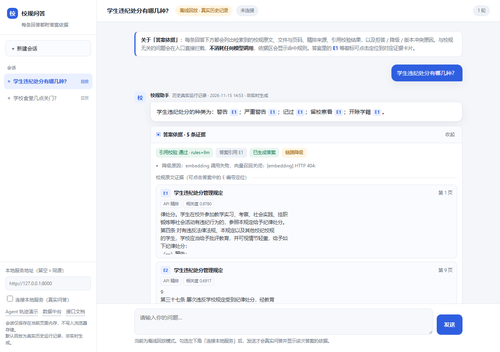
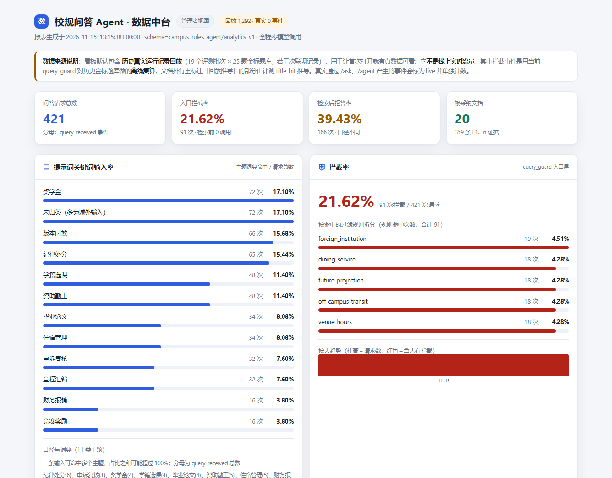

# campus-rules-agent · 校规问答 Agent

> **项目简介**
> 面向上海对外经贸大学官方校规的问答 Agent。基于 8751 个切块、131 份文件 / 3809 页构建混合检索链路，
> 以「答得准、可溯源、链路不完整时宁可拒答」为目标：**手写 Agent Loop**（显式状态 → 结构化决策 JSON →
> 工具 → 观察 → 收敛，含确定性兜底与三类护栏），不依赖任何编排框架；配套 **25 题金标题库 + 六组消融实验 +
> 生成后引用校验**，把「准确性」变成可复现的量化指标；再以 **结构化事件数据中台** 把单条决策轨迹扩展到
> 管理者视角的运营指标。全程可离线自检（136 项、0 次模型调用），所有降级显式留痕，不假装执行过。
> 项目聚焦链路可解释与结果可复现：state / tool / termination / guardrail / evaluation /
> observability 全部做成显式、可审计的代码，不依赖编排框架，也不做认证 / 限流 / Docker / CI /
> 多用户隔离等上线工程。

---

## 0. 一分钟速览

| 维度 | 做法 |
|---|---|
| 数据 | 8751 切块、1024 维已归一化向量、131 份官方文件 / 3809 页，**只读引用、不重建、不入库** |
| 编排 | 两条路径并存：`QAPipeline.ask` 固定流水线（baseline）／`AgentLoop.run` 手写循环；不用 LangGraph / LangChain / LlamaIndex |
| 检索 | 向量 + BM25 双路召回 → RRF → 邻块扩展 → 规则预筛 → API rerank → 时效纠偏 |
| 生成 | 每个结论强制带 `[E#]` → 生成后引用校验（规则 + LLM）→ 不过则修正或拒答 |
| 入口 | `query_guard` 纯本地保守放行，域外问题检索前短路，**0 次模型调用** |
| 记忆 | SQLite 多轮，按 `session_id` 隔离，进程重启可恢复 |
| 可观测 | 脱敏 trace + Agent 决策轨迹页 + 结构化事件数据中台看板 |
| 评测 | 25 题金标题库、六组消融、默认 dry-run、双闸门；累计 1732 次已批准的实测调用 |
| 交付 | CLI + FastAPI + 三个单文件零依赖页面；版本 `0.6.0`，离线自检 **136/136、0 次模型调用** |

---

## 1. 项目介绍

### 1.1 概述

这是一个「准确性优先」的校规问答 Agent。项目不使用现成编排框架，而是手写了完整的
`AgentState → 决策 JSON → 工具注册表 → 观察 → 收敛` 循环，带重复动作 / 连续失败 / 最大步数三类护栏
和确定性 policy 兜底，并保留一条固定流水线作为消融对照组。检索侧把向量召回、BM25、RRF、
邻块扩展、规则预筛、独立 rerank API 与时效纠偏串成一条可审计的链路；生成侧用四条红线
（逐条溯源、证据不足即拒答、生成后引用校验、时效 / 版本冲突）约束输出，任何一处不满足就收敛为固定拒答。
为验证这些设计，项目配套 25 题金标题库与六组消融，通过真实模型调用逐轮定位缺陷，
把自主决策组的拒答判定准确率从 0.60 提到 0.96、引用核查通过率从 0.556 提到 1.00。
最后补了一层结构化事件数据中台：管理者能看到关键词输入率、拦截率与被采纳最多的校规章程，
而事件表从接口形状上就不允许写入用户提示词原文。

### 1.2 关键能力与量化结果

- 基于 8751 切块 / 131 份官方文件构建校规 RAG，**手写 Agent Loop**（显式状态、结构化决策 JSON、
  6 个工具、三类护栏、确定性兜底、脱敏轨迹），零编排框架依赖；实现混合召回 + RRF + 邻块扩展 +
  API rerank + 生成后引用校验的完整准确性链路。
- 设计 **25 题金标题库与六组消融实验**，通过累计 1732 次真实模型调用定位并修复 5 类准确性缺陷；
  自主决策组拒答判定准确率 **0.60 → 0.96**、引用核查通过率 **0.556 → 1.000**、
  降级率 **0.04 → 0**，对照组无回归；新增答案级 `fact_recall` 解决标题命中率饱和问题。
- 实现**结构化事件数据中台**与零依赖单文件看板（关键词输入率 / 拦截率 / 被索引最多的数据），
  事件库与短期记忆物理分离、以 `meta.rid` 保证拦截率按请求去重、历史回放幂等且显式标注非线上流量；
  **隐私 by shape**（DDL 与写入签名均无原文字段），配套 136 项零 API 调用离线自检。

### 1.3 三个关键设计决策

1. **「要不要调模型」不该用模型判断**：入口过滤若先调一次 LLM 分类，就是成本悖论。
   因此用纯本地正则 + 保守放行（fail-open），误伤合法校规提问的代价远大于多跑一次检索；
   隐晦域外题交给检索后的相关性门槛兜底。
2. **相关性阈值必须知道分数的来源**：早期用语义绝对阈值，该拒的题得分 0.7988，
   不该拒的题得分 0.7836 —— 阈值根本不可分。改为「词面 IDF 覆盖率主判（≥0.30 直接放行）
   + 仅当证据来自 API rerank 且语义 ≥0.80 才补位」，规则重排的分数尺度下自动关闭语义项。
3. **运营指标要按请求去重，日志要按职责分库**：一次请求可命中多条软规则，
   按规则命中次数算拦截率会超过 100%；且短期记忆会被 `clear` 清空，不能拿来存运营统计。
   因此事件库独立、用 `meta.rid` 归并分子，按规则拆分另列。

---

## 2. 效果一览

**问答界面**：每条回答下方强制挂「答案依据」区 —— 校规原文片段、文件与页码、精排来源、
相关度、引用校验状态、拒答 / 降级原因；答案里的 `[E1]` 徽标可点击定位。不提供推荐问题，
发送各阶段的状态反馈都在对话流内可见。



**数据中台看板**：管理者视角的关键词输入率、拦截率（按规则 / 按天）与被索引最多的数据。
下图是**纯历史回放基线**快照（不是线上流量）；可离线打开
[`docs/dashboard_snapshot.html`](docs/dashboard_snapshot.html)，断网也能看。



---

## 3. 快速开始

### 3.1 一键启动（Windows）

双击项目根的 `start.bat`：用自带 `.venv` 启动 FastAPI，轮询本地 `/analytics/summary`
确认**当前版本服务就绪**后自动打开 `http://127.0.0.1:8000/dashboard`。
关闭控制台窗口即停止服务；服务已在运行时不会重复拉起，只把浏览器带过去。
启动服务、打开看板、看离线回放**均 0 次模型 API 调用**。

```powershell
cd campus-rules-agent
.\.venv\Scripts\python.exe -m campus_rules serve --open          # 默认打开 /dashboard
.\.venv\Scripts\python.exe -m campus_rules serve --open --open-page chat  # 改开问答界面
```

### 3.2 打开哪些页面

| 想看什么 | 地址 |
|---|---|
| 问答机器人（面向使用者，每条回答带依据） | `http://127.0.0.1:8000/chat` |
| 数据中台看板（管理者视角） | `http://127.0.0.1:8000/dashboard` |
| Agent 决策轨迹（thought → tool → observation） | `http://127.0.0.1:8000/demo` |
| 聚合指标 JSON / 接口文档 | `/analytics/summary` · `/docs` |
| 离线看板快照（不用起服务） | `docs/dashboard_snapshot.html` |

`/chat` 与 `/demo` 默认回放**真实历史运行记录**并显式标注「非实时生成」，不伪造答案；
勾选「连接本地服务」后发问才会走真实链路。

### 3.3 数据依赖（clone 后必读）

数据文件**不随仓库分发**（体量与授权原因），`.gitignore` 已排除 `*.npy` / `*.jsonl`
（仅放行 `eval/golden.jsonl`）。要跑完整问答 / 评测，需自备同结构的目录：

```
<DATA_DIR>/
├── vectors.npy      (8751, 1024) float32，已归一化
├── meta.jsonl       8751 行，与 vectors.npy 第 i 行严格对齐
├── chunks.jsonl     8751 行
└── 校规源文件.json  131 份文档 / 3809 页
```

复制 `.env.example` 为 `.env`，把 `DATA_DIR` 指向该目录；密钥全部留空也能跑本地链路，
此时会明确打印 `⚠ degraded` 但**不会生成答案**。`VectorStore.load()` 用 `mmap_mode="r"`，
并硬校验行数一致，不一致直接拒绝启动；项目**不向数据目录写入任何文件**。

无数据时仍可查看：本 README、两张截图、`docs/dashboard_snapshot.html`、
`python -m campus_rules analytics`（读已落盘事件库）、`web/` 下的静态模板。

---

## 4. 正确率是怎么提上来的

这是本项目最核心的部分：**不是一次调通，而是用评测把缺陷一个个逼出来**。

### 4.1 评测怎么做的

- `eval/golden.jsonl`：25 题金标题库，5 类（事实 / 多跳 / 版本冲突 / 拒答 / 多轮），
  每题带 `expected_titles`、`expect_refusal`、`key_facts`；**全部 `needs_review=true`**，
  不把金标包装成人工复核过的标准答案。
- 六组对照：`A0` 固定流水线、`A4` Agent 自主决策、
  `A1` 关 rerank、`A2` 关邻块扩展、`A3` 关引用校验、`A5` 关确定性 policy（全 LLM 决策）。
- 指标：拒答判定准确率、引用核查通过率、版本冲突检出率、标题命中率、
  答案级事实召回 `fact_recall`、降级率、平均工具步数、模型调用数。
- 默认 dry-run（零调用）；真实运行需 `--run --confirm-api-calls` 双闸门，
  且按项目约定**必须先列接口 / 次数 / 用途并获批准**。
- 结果逐批落盘在 `eval/results/*.json`，不覆盖历史批次，可逐项复核。

### 4.2 提升链路（全部来自真实实测，数字可追溯到文件名）

| 阶段 | 证据文件 | 指标变化 | 根因 → 修复 |
|---|---|---|---|
| 首轮全量 | `20261115_baseline.json` | 拒答判定准确率 **0.64**；引用通过率 1.00 却是**假象**（5 道拒答题全漏拒）；版本冲突检出 **0.00** | 缺生成前相关性硬门槛；核查器不问「证据能否回答本轮问题」；版本 key 带日期前缀 |
| 9 题定点诊断 | `diagnose.json` → `diagnose3.json` | 拒答判定准确率 **0.222 → 1.000** | 加相关性硬门槛 + 核查器相关性检查 + 答案系统「只答本轮问题」约束 |
| v0.2 六组 | `A0_fixed` … `A5_agent_llm` | A0 拒答 **0.64 → 0.80**；版本冲突检出 **0.00 → 0.60**；A1（关 rerank）只有 0.20，暴露语义绝对阈值误伤 | 版本 key 归一化（去日期 / 校名前缀）、候选池前 40 块检测 |
| v0.3 六组复验 | `v03_A0` … `v03_A5` | A0 拒答 **0.80 → 0.92**；A1 **0.20 → 0.84**；A0 降级率 **0.40 → 0.04** | 词面主判 + 语义补位 + 分数尺度感知；红线拒答不再污染 `degraded`；消融组 `citation_ok` 返回 `None` 不进分母 |
| v0.4 核查循环修复 | `v04_A4.json` | A4 拒答 **0.60 → 0.96**；引用核查通过 **0.556 → 1.000**；降级率 **0.04 → 0**；平均步数 **5.36 → 5.00**；**10 个误拒救回 9 个** | 生成 / 核查统一用本轮 `raw_query`；核查器加「禁止间接推断」；年份数字降为 warning；带核查意见确定性重生成一次 |
| v0.4 对照组 | `v04_A0.json` | 拒答 0.92、引用 0.9474、调用 99 次，与 v0.3 **逐题判定完全一致（无回归）** | 修复只作用在 Agent 自我修正循环 |
| v0.4 新指标 | `v04_A0/A4` | 标题命中率六组恒 1.00（金标饱和）→ 新增答案级 `fact_recall`：A0 **0.6042** / A4 **0.6542** | 为 20 道正常题补 `key_facts` 答案级金标 |
| v0.5 入口过滤 | 离线验证（0 次调用） | 25 题金标 **5 挡 20 放**；域外题 **0 次模型调用**；dry-run 上限 **175 → 140 次** | 纯本地 `query_guard`，检索前短路；不写会话记忆、不回显原文 |

### 4.3 最新消融矩阵（v0.3 全量 + v0.4 两组，均为真实调用）

| 组 | 拒答准确率 | 引用核查通过 | 冲突检出 | 降级率 | 调用数 |
|---|---|---|---|---|---|
| A0 固定流水线（v0.3） | 0.92 | 0.9474 | 0.60 | 0.04 | 99 |
| A1 关 rerank | 0.84 | 1.00 | 0.60 | 0.00 | 62 |
| A2 关邻块扩展 | 0.88 | 0.8947 | 0.60 | 0.08 | 101 |
| A3 关引用校验 | 0.92 | `null`（消融不评分） | 0.60 | 0.04 | 74 |
| A4 自主决策（v0.3） | 0.60 | 0.5556 | 0.60 | 0.04 | 87 |
| A5 全 LLM 决策 | 0.76 | 0.6667 | 0.40 | 0.40 | 242 |
| **A4 自主决策（v0.4）** | **0.96** | **1.00** | 0.60 | **0.00** | 92 |
| A0 对照（v0.4） | 0.92 | 0.9474 | 0.60 | 0.04 | 99 |

> A5 保留它不是为了跑分，而是为了展示状态机、工具选择与护栏的代价：
> 每步都要一次 LLM 决策，218～242 次/组，拒答准确率反而低于 A0。这个「负面结果」如实保留。

### 4.4 口径警告（务必别混比）

- **4.2 表中 v0.2 / v0.3 / v0.4 的实测值全部是「入口过滤加入之前」**。
  v0.5 起 5 道拒答题改为 0 调用、不计入引用核查分母，`total_api_calls` 与
  `citation_scored_cases` 会下降 —— 这是**分母变化，不是通过率下降**。
- v0.4 只复验了 A0 / A4 两组（省调用），**最新完整六组矩阵仍是 v0.3**。
- `title_hit_rate` 六组恒 1.00 说明金标题库已饱和，不能当「答案正确率」；
  `fact_recall` 只校验关键事实是否出现，不校验表述 / 顺序 / 完整性，且锚点偏严，
  低分既可能是答非所问也可能只是措辞差异 —— 结果文件不存答案全文，无法离线判定，
  全部保留 `needs_review=true`，不回改已落盘结果。
- V02（问「先后发布过哪些版本」的元问题）六组全错，词面 0.157 / 语义 0.515 两层信号都弱，本期未处理。

---

## 5. 数据中台看板的作用

### 5.1 管理者能看到什么

| 指标 | 口径 | 基线快照（纯历史回放） |
|---|---|---|
| 提示词关键词输入率 | 11 类内置校规主题词典命中 / 请求总数，允许多标签 | 421 次请求；「未归类」「奖学金」各 17.10% 居前 |
| 入口拦截率 | `query_guard` 检索前拦截的**请求数** / 请求总数，按规则与按天拆分 | 91 / 421 = **21.62%**；检索后拒答 166（39.43%）单列 |
| 被索引最多的数据 | 最终进入答案 `E1..En` 的证据，按清洗标题归并 | 359 条证据 / **20 份文档**；Top 3：家庭经济困难学生认定办法 35、学生违纪处分管理规定 34、学生申诉处理办法 33 |

另有来源分布、按天趋势、口径与隐私说明。看板同时标出「历史回放 / 真实运行」事件数，
当前基线 `live_events=0`；真实 `/ask`、`/agent` 会写入 live 事件并单独计数。

### 5.2 每个指标对应什么运营决策

- **关键词输入率** → 学生真正关心哪些校规主题。「未归类」占比高说明主题词表覆盖不足，
  需要补词或补语料；某一主题长期为零，可能是入口措辞与官方文件名不一致。
- **拦截率** → 判断入口过滤是否过严 / 过松。按规则拆分能看出哪类域外问法最多
  （基线里 `foreign_institution` 19 次居首），指导规则迭代；与「检索后拒答率」分开，
  避免把「没拦住」误读成「答不上来」。
- **被索引最多的数据** → 优先保证高频规章的切块质量、时效与版本正确性；
  若历年《管理文件汇编》排到前列，就要检查时效降权是否被 API rerank 覆盖。

### 5.3 工程实现

- **四类事件**：`query_received`（分母）、`guard_blocked`（分子）、
  `evidence_used`（证据热度）、`answer_completed`（拒答 / 调用数），落独立 `var/analytics.db`，
  与短期记忆 `memory.db` **物理分离**（后者会被 `clear` 清空，生命周期不同）。
- **隐私 by shape**：事件表 DDL 没有 `query / content / prompt` 列，`record()` 签名也没有原文参数；
  用户输入只在内存里喂给 `classify()`，提取完即丢弃；自检用 `all_text()` 断言金标 query 零泄漏。
  `PromptSink` 原文采集协议**仍未实现**。
- **指标正确性**：一次请求可命中多条软规则，`_track()` 逐规则写事件，
  所以用 `meta.rid` 归并回同一请求 —— `guard_rate` 分子取被拦请求数，
  `guard_rule_hits` 单列为规则命中次数，避免了 >100% 的拦截率。
  自检专门用独立内存库回归「1 请求 / 3 规则 → rate = 1.0」。
- **诚实回放**：19 个评测批次 / 421 请求 / 30 条真实 E 证据，全部标 `replay:*`；
  `replay:guard_recompute` 是**当前规则对历史金标的离线复算，非当时真实拦截**，
  `replay:title_hit` 是由 `title_hit=True` 推导；`dedup_key` + `INSERT OR IGNORE` 保证幂等。
- **零依赖交付**：`web/dashboard.html` 单文件、零 CDN，靠 `/*__ANALYTICS_DATA__*/` 注入报表；
  未注入时显示诚实空状态而非伪造 KPI。CLI `analytics --html` 可导出断网可看快照。
- **统计不污染问答**：写入异常只记 warning；只读端点、CLI、评测、离线自检都不写事件；
  自检用 `AnalyticsStore(":memory:")`，不污染真实库。

### 5.4 口径与隐私边界

1. 回放不等于线上流量：19 个批次跑的是**同一套 25 题金标题库**，主题分布被重复放大。
2. `/ask` 的 `AnswerResult` 不携带调用计数，live 事件显式写 `api_calls_known=false`、`n=0`，
   **不把「取不到」伪装成「消耗为 0」**；`/agent` 的脱敏 trace 带真实 `api_calls`。
3. 看板不做登录 / 权限 / 多用户隔离（与「不上线」的项目定位一致）；
   `var/analytics.db` 与快照是可重建的运行产物，已被 `.gitignore` 忽略。
4. `docs/` 下的截图与快照是**纯回放基线**，不含任何用户提示词原文，可安全随仓库分发。

---

## 6. 架构与核心设计

### 6.1 两条编排路径

`QAPipeline.ask` 是固定流水线（baseline，也是消融对照组与 LLM 挂掉时的兜底）；
`AgentLoop.run` 是手写循环。保留两者才能证明自主决策的收益与代价。

### 6.2 手写 Agent Loop

显式 `AgentState`（问题、证据、决策历史、工具调用轨迹、终止原因）→
结构化决策 JSON → `ToolRegistry`（6 个工具）→ 观察回写 → 判断够不够 →
必要时自我修正。护栏有三类：**重复动作**（同一 query 反复 retrieve）、
**连续失败**、**最大步数**；LLM 决策失败 / JSON 解析失败 / 未知工具时回退确定性 policy。
终止原因显式区分 `VERIFIED / REFUSED / GUARD_BLOCKED / MAX_STEPS / POLICY_FALLBACK / ERROR`。
轨迹导出默认脱敏，不输出用户原始提示词全文。

### 6.3 检索链路与四条准确性红线

向量召回 + BM25 → RRF 融合 → 邻块扩展（修复 300 字固定切块截断「第 X 条」）→
规则预筛（把 200+ 候选收敛到 40 块）→ 独立 rerank API → **精排后时效纠偏**
（历年《管理文件汇编》×0.75 + 时效因子重排，防止精排模型把旧汇编顶到 #1）→
证据打包 → 严格提示词生成 → 生成后引用校验（规则 + LLM 双通道）。

| 红线 | 实现 | 违反时 |
|---|---|---|
| 逐条溯源（文件 + 页码 + 条款） | `ANSWER_SYSTEM` 规则 1、`Evidence.label` | 引用编号不存在 → `verification.ok=false` |
| 证据不足即拒答 | `relevance.assess_relevance` 词面主判 + 语义补位 + 阈值门 | 生成前收敛为固定拒答，连 LLM 都不送 |
| 生成后引用校验 | `verification.verify_answer`（含「证据能否回答本轮问题」） | baseline 重试一次；Agent 把失败原因交回决策器自我修正 |
| 时效 / 版本冲突 | 汇编降权、`detect_version_conflicts` | 并列展示各版本并标注出处，**不擅自裁决哪个有效** |

两句固定拒答刻意区分失败位置：检索后证据不足 →
`现有校规文件中未找到该问题的明确依据，建议咨询学校相关职能部门。`；
入口层域外过滤 → `无法回答与校规无关的问题。本助手仅依据上海对外经贸大学校规文件回答与校规相关的提问。`

### 6.4 降级可观测

配置缺失时降级为「BM25 + 规则重排」，输出必须标注 `degraded` 与原因，
**不静默跳过、不假装已重排 / 已生成**。红线主动拒答单列 `redline_refusals`，
不污染 `degraded` 指标（这是 v0.3 修掉的口径 bug）。

### 6.5 隐私边界

用户提示词原文**不落盘、不回显、不进 trace / 结果文件 / 事件库**；
`/chat` 会话只存当前页面内存，不使用 `localStorage` / `sessionStorage`；
架构预留四处（`QueryRequest.raw_query`、`PromptSink` 协议、SQLite 表结构、本 README 第 9 节），
但采集逻辑本期不实现。

---

## 7. 工程化与配置

```
campus-rules-agent/
├── .env.example               # 可入库配置模板（密钥留空、无本机路径）
├── .gitignore                 # 密钥 / venv / 运行产物 / 大文件；放行 golden.jsonl 与 docs/
├── pyproject.toml             # 元数据、依赖、ruff、CLI 入口（version 0.6.0）
├── requirements.txt / requirements.lock.txt   # 依赖锁定（lock 不含本地 editable 路径）
├── start.bat                  # 一键启动：起服务 + 就绪后自动打开看板
├── docs/                      # 文档配图与离线看板快照（刻意入库）
├── eval/golden.jsonl          # 25 题金标题库
├── eval/harness.py            # 评测 / 消融 / dry-run 双闸门
├── eval/offline_selfcheck.py  # 136 项零模型调用离线自检
├── eval/results/              # 评测产物（已 gitignore）
├── web/{index,chat,dashboard}.html   # 三个单文件零依赖页面
├── var/                       # 运行产物：bm25.pkl / memory.db / analytics.db / traces/（已 gitignore）
└── src/campus_rules/
    ├── config.py schema.py memory.py logging_conf.py text_utils.py
    ├── prompts.py verification.py relevance.py query_guard.py
    ├── pipeline.py cli.py api.py
    ├── analytics/{store,topics,report,seed,view}.py   # 数据中台
    ├── agent/{state,policy,tools,loop,trace}.py       # 手写 Agent Loop
    ├── index/{vector_store,bm25_store,hybrid}.py
    └── adapters/{base,errors,embedding,rerank,llm}.py
```

配置集中在 `config.Settings`，其他模块不得直接 `os.getenv`。
`query_guard.py` 与 `analytics/` 刻意**零配置**（纯本地正则 / SQLite + 内置词表），
不需要任何新 `.env` 项。Embedding 必须与建库模型一致；rerank 是独立端点，
`RERANK_API_URL` 若已是完整服务路径，`RERANK_API_PATH` 必须留空。

```powershell
python -m venv .venv; .\.venv\Scripts\Activate.ps1
pip install -r requirements.txt; pip install -e .
cp .env.example .env        # 填 DATA_DIR 与可选密钥
python -m campus_rules config        # 能力摘要，不输出密钥
python -m campus_rules build-index   # 首次构建 BM25
python -m campus_rules check         # 数据对齐 + 索引 + 试检索
```

### 命令与接口速查

| 命令 / 接口 | 作用 |
|---|---|
| 双击 `start.bat` | 一键启动：起服务 + 就绪后自动打开 `/dashboard`（0 次模型调用） |
| `serve --open [--open-page dashboard\|chat\|demo\|docs]` | 启动并自动开浏览器；服务已运行则幂等只带浏览器过去 |
| `ask "问题" --session s1` / `agent "问题" --mode policy --trace-html ...` | 固定流水线 / 手写 Agent Loop（policy 模式零模型调用） |
| `eval --mode baseline\|agent [--run --confirm-api-calls]` | 评测 / 消融，默认 dry-run |
| `analytics [--json] [--html PATH] [--reseed] [--top-docs N]` | 数据中台报表 / 独立看板快照（零模型调用） |
| `python -m eval.offline_selfcheck` | 136 项零 API 调用离线自检 |
| `GET /health` `POST /ask` `POST /agent` `GET /agent/tools` `GET /guard/rules` `POST /guard/check` `GET /analytics/summary` `GET /dashboard` `GET /demo` `GET /chat` `POST /retrieve` `GET,DELETE /sessions/{id}` | HTTP 接口 |

> **API 调用治理（硬性约定）**：`/ask`、`/agent` 在外部能力已配置时会真实消耗模型调用，
> 发起前须先列接口 / 次数 / 用途并获得明确批准。`GET /guard/*`、`POST /retrieve`、
> `GET /analytics/summary`、`GET /dashboard`、`analytics` 命令、dry-run 与自检
> **不调用任何模型**，也不写运营事件，可随时本地运行。

---

## 8. 诚实清单（已知边界）

1. **不是上线系统**：不做认证 / 限流 / Docker / CI / 多用户隔离；看板也无登录与权限。
2. **数据不入库**：clone 后需自备 `<DATA_DIR>`；无数据时完整问答与评测跑不起来（见 3.3）。
3. **向量前缀不一致**：建库 embedding 带「标题 > 页码」前缀，查询侧无法复现；
   本期不重建向量（约 438 次 embedding 调用），以 BM25 + 邻块扩展 + 重排兜底。
4. **历史数值不可跨版本混比**：见 4.4；v0.4 只复验 A0 / A4，最新全量矩阵仍是 v0.3。
5. **金标不是标准答案**：全部 `needs_review=true`；`fact_recall` 锚点偏严，低分需人工复核。
6. **V02 元问题六组全错**；推理模型偶发 `reasoning_content` 耗尽 token 预算（已加自动翻倍重试）。
7. **入口过滤是词表 / 正则，不是开放域分类器**：5 挡 20 放只在当前 25 题金标上验证过，
   隐晦域外题会保守放行，仍需检索后相关性门槛兜底。
8. **看板回放不是线上流量**：21.62% 拦截率是离线复算口径；真实 live 事件会另行累加。
9. **pytest 单测按约定延后**，当前以 136 项离线自检 + 真实评测作为验证手段。
10. 全部 `eval/results/*.json` 与 `var/` 运行产物均可重建，不随仓库分发。

---

## 9. 后续需求（原文采集仍不实现，仅架构预留）

需要采集「用户输入的提示词数据」。v0.6 经确认把早期「不写任何采集逻辑 / 埋点 / 落盘」
**只放宽到结构化元数据**：允许把内置主题标签、过滤规则名、校规文档公开元数据、整数计数
写进 `var/analytics.db`；但**用户提示词原文依然一行都不落盘、不回显、不进 trace / 结果文件**。
`PromptSink` 采集协议仍未实现，也没有任何「开启原文采集」的开关；
域外被拦问题仍不写 `memory.turns`。四处架构预留保持不变。

---

## 10. 附录 · 实测记录与调用治理

| 阶段 | 真实调用 | 关键结果 |
|---|---|---|
| 联调与协议适配 | 8 次 | 定位 DashScope 原生 embedding / rerank 请求体、rerank 400、汇编降权被覆盖 |
| 首轮评测 A0 / A4 | 197 次 | 暴露拒答红线漏洞与 4 题生成失败 |
| 三轮小批诊断 | 66 次 | 定位推理模型 `reasoning_content` 耗尽预算；9 题双门槛 0.222 → 1.0 |
| v0.2 六组全量 | 601 次 | 修复后完整矩阵；A5 因每步 LLM 决策实际 218 次/组 |
| 界面真实 HTTP 联调 | 4 次 | 证据带原文 / 页码 / 汇编标记；观测到 v0.3 语义补位生效 |
| v0.3 六组全量复验 | 665 次 | A0 0.80→0.92、A1 0.20→0.84；A4 0.64→0.60 暴露循环收敛瓶颈 |
| v0.4 精简复验 | 191 次 | A4 0.60→0.96、引用 0.556→1.00、10 个误拒救回 9 个；全程无 429 |
| v0.5 / v0.6 / 一键启动 / 界面反馈 | **0 次** | 纯本地实现 + 离线自检，136/136 通过 |

> 自动化评测与联调累计 **1732 次**（全部先列清单获批，逐次可追溯到 `eval/results/`）；
> 这个数字**不含使用者在界面上自行发起的实时提问**。
> v0.3 复验清单上限 1075 次、实际 665 + 4；v0.4 清单上限 325 次、实际 191（约全量的 18%）。
> 所有 dry-run 与双闸门持续有效；本仓库不含任何真实密钥。
